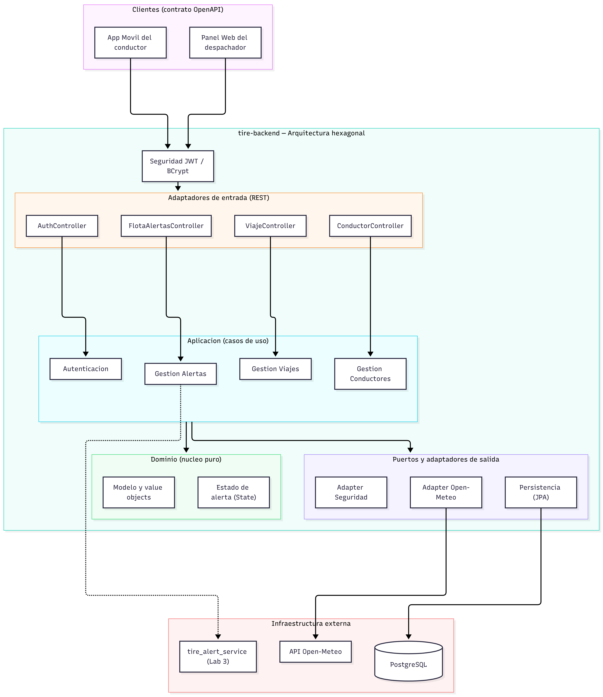

# Arquitectura actual del sistema (Prototipo 1)

> Este documento describe la arquitectura **tal como se implementó** en el Prototipo 1.
> La visión objetivo de microservicios, planteada en iteraciones previas, se conserva
> en [ARQUITECTURA_ANTERIOR.md](./ARQUITECTURA_ANTERIOR.md) como referencia de hacia
> dónde puede evolucionar el sistema.

> Fuente del diagrama: [`componentes_arquitectura.mmd`](./componentes_arquitectura.mmd) (Mermaid).

## 1. Resumen

Para el MVP no se construyó un conjunto de microservicios independientes. En su lugar
se implementó un **monolito modular** con **arquitectura hexagonal (puertos y
adaptadores)** estricta:

- **Backend (`tire-backend`):** Java 17 + Spring Boot 3.2.5. Único servicio que
  expone una API REST documentada con **OpenAPI 3.0.3**. El dominio es Java puro (sin
  anotaciones de Spring, JPA ni Jackson) y las dependencias siempre apuntan hacia
  adentro: `infrastructure → application → domain`.
- **Clientes:** App Móvil (React Native, con detección de visión y alarma locales en
  el dispositivo) y Panel Web del despachador (React SPA). Ambos consumen el backend a
  través del contrato OpenAPI.
- **Base de datos:** PostgreSQL 16, levantada con `docker-compose` (en tests se usa H2
  en modo PostgreSQL).
- **Servicio de alertas (`tire_alert_service`, Laboratorio 3):** componente aparte en
  TypeScript/Node.js que modela el escalamiento multicanal de incidentes. En el
  Prototipo 1 la lógica de alerta crítica para el despachador vive dentro del backend
  (módulo de Alertas); `tire_alert_service` es la evolución de esa responsabilidad
  hacia un servicio dedicado.

La diferencia principal frente a la arquitectura anterior es que los "microservicios"
de autenticación, flota, viajes/telemetría y alertas se materializaron como **cuatro
módulos de dominio dentro de un solo backend hexagonal**, no como servicios
desplegables por separado.

## 2. Capas y componentes implementados

### 2.1 Clientes

- **App Móvil del conductor** (React Native): captura de cámara, inferencia de visión
  (EAR) y alarma sonora se ejecutan **localmente en el teléfono**, sin enviar video ni
  imágenes a la red. Envía al backend telemetría, eventos de fatiga y confirmaciones.
- **Panel Web del despachador** (React SPA): supervisa el estado de la flota y gestiona
  las alertas críticas.

Ambos se comunican con el backend mediante el contrato **OpenAPI 3.0.3** (`openapi.yaml`).

### 2.2 Seguridad (transversal)

- `JwtAuthenticationFilter` + `SecurityConfig`: autenticación **stateless** con **JWT**
  (JJWT 0.12.5) y control de roles `CONDUCTOR` / `DESPACHADOR`.
- `JwtBcrypAuthAdapter`: adaptador que une `BCryptPasswordEncoder` y la emisión/
  validación de tokens con el puerto de dominio `ProveedorAutenticacionPort`.
- Manejadores `CustomAuthenticationEntryPoint` (401) y `CustomAccessDeniedHandler`
  (403) que responden bajo el estándar **RFC 9457** (`application/problem+json`).

### 2.3 Adaptadores de entrada — `infrastructure.adapter.in.rest`

Controladores REST y sus DTOs:

| Controlador | Rutas | Rol |
|---|---|---|
| `AuthController` | `/auth/registro`, `/auth/sesion`, `/auth/contrasena`, `/auth/recuperacion` | Público / autenticado |
| `ConductorController` | `/conductores`, `/conductores/{id}` | DESPACHADOR |
| `ViajeController` | `/viajes`, `/viajes/{id}`, `/viajes/{id}/telemetria`, `/viajes/{id}/eventos`, `/viajes/{id}/confirmar-alerta` | CONDUCTOR (y consulta DESPACHADOR) |
| `FlotaAlertasController` | `/flota/estado`, `/alertas`, `/alertas/{id}/atender`, `/incidentes` | DESPACHADOR |

Los errores se centralizan en `GlobalExceptionHandler`.

### 2.4 Aplicación — `application`

- **Puertos de entrada (casos de uso):** `AutenticacionUseCase`,
  `GestionConductoresUseCase`, `GestionViajesUseCase`, `GestionAlertasUseCase`.
- **Servicios (orquestación):** `AutenticacionService`, `GestionConductoresService`,
  `GestionViajesService`, `GestionAlertasService`.
- **Comandos:** `ComandoRegistro`, `ComandoCrearConductor`, `ComandoActualizarConductor`,
  `ComandoIniciarViaje`, `ComandoTelemetria`, `ComandoEventoFatiga`.
- **Puertos de salida (`application.port.out`):** `UsuarioRepositoryPort`,
  `ConductorRepositoryPort`, `ViajeRepositoryPort`, `AlertaCriticaRepositoryPort`,
  `ProveedorAutenticacionPort`, `ConsultorClimaPort`.

### 2.5 Dominio — `domain` (Java puro)

- **`model`:** `Viaje` (agregado raíz), `Conductor`, `Usuario`, `EventoFatiga`,
  `AlertaCritica`.
- **`valueobject`:** `Ubicacion`, `NivelAlerta`, `EstadoViaje`, `RolUsuario`,
  `CondicionClimatica`.
- **`state`:** patrón **State** del nivel de alerta — `EstadoAlertaState`,
  `EstadoNormal`, `EstadoPrecaucion`, `EstadoCritico` y `FabricaEstadoAlerta`.
- **`exception`:** `ReglaNegocioException`, `ConflictoEstadoException`,
  `RecursoNoEncontradoException`, `AccesoDenegadoDominioException`.

### 2.6 Adaptadores de salida — `infrastructure.adapter.out` / `infrastructure.security`

- **Persistencia (JPA / Spring Data):** `*PersistenceAdapter` + `*JpaEntity` +
  `SpringData*Repository` para usuarios, conductores, viajes y alertas críticas.
  Objetos embebidos: `UbicacionEmbeddable`, `CondicionClimaticaEmbeddable`.
- **Seguridad (patrón Adapter):** `JwtBcrypAuthAdapter` (BCrypt + JJWT).
- **Integración externa (patrón Adapter):** `OpenMeteoClimaAdapter` consume la API
  pública **Open-Meteo** con `java.net.http.HttpClient` para enriquecer la telemetría
  con el clima de la ruta.

### 2.7 Infraestructura externa

- **PostgreSQL 16** (`tire_db`) vía `docker-compose`.
- **API Open-Meteo** (clima en ruta).
- **`tire_alert_service`** (Lab 3, TypeScript/Node.js): también hexagonal, con seis
  patrones GoF (Factory Method, Builder, Adapter, Decorator, Strategy, State) para el
  escalamiento de incidentes por SMS, Push FCM y Dashboard.

## 3. Patrones de diseño implementados

| Patrón | Dónde | Propósito |
|---|---|---|
| **State** | `domain.state` (`EstadoAlertaState` y estados concretos) | Transiciones del nivel de alerta `NORMAL → PRECAUCION → CRITICO` sin condicionales anidados. |
| **Adapter** | `JwtBcrypAuthAdapter`, `OpenMeteoClimaAdapter` | Traducir librerías/APIs externas (BCrypt, JJWT, Open-Meteo) a los puertos del dominio. |
| **Factory** | `FabricaEstadoAlerta` | Rehidratar el estado de alerta desde el nivel persistido. |

En `tire_alert_service` (Lab 3) se añaden **Factory Method, Builder, Decorator y
Strategy** sobre State y Adapter.

## 4. Principios SOLID

- **SRP:** cada servicio de caso de uso cubre un objetivo acotado.
- **OCP:** nuevos niveles de alerta se agregan con nuevas clases State sin tocar `Viaje`.
- **LSP:** cualquier `EstadoAlertaState` es intercambiable donde se espera la interfaz;
  los repositorios (PostgreSQL o H2 en tests) respetan sus puertos.
- **ISP:** puertos pequeños y específicos por responsabilidad.
- **DIP:** la aplicación y el dominio dependen de puertos (interfaces); la
  infraestructura se conecta por inyección de dependencias en los adaptadores.

## 5. Atributos de calidad soportados

- **Privacidad:** el procesamiento facial ocurre solo en el dispositivo; el backend no
  recibe imágenes ni video.
- **Disponibilidad (offline-first):** la alarma en cabina es local y funciona sin red;
  la telemetría se sincroniza cuando hay cobertura.
- **Seguridad:** JWT + BCrypt, respuestas 401/403 estructuradas bajo RFC 9457.
- **Mantenibilidad:** la arquitectura hexagonal permite sustituir adaptadores
  (persistencia, clima, seguridad) sin alterar el dominio.
