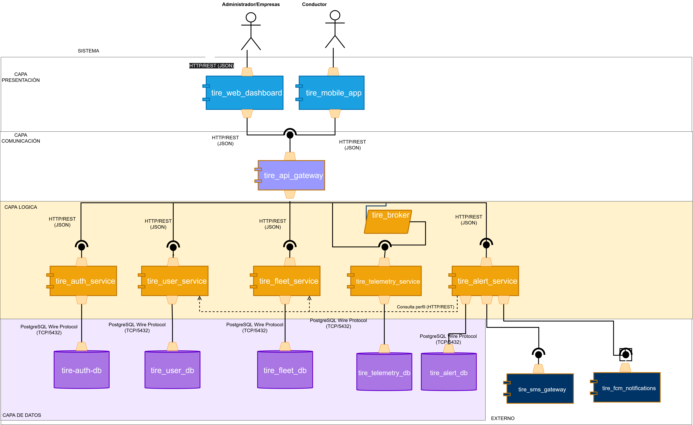

# Arquitectura del Sistema

## 2.2 Componentes del sistema

### Capa de Presentación

- **tire_mobile_app**: Aplicación móvil principal instalada en el smartphone del conductor. Actúa como el único dispositivo de captura en cabina para todos los usuarios (particulares B2C y flotas B2B). Responsabilidades:
  - Capturar video en tiempo real a través de la cámara frontal.
  - Recolectar datos de telemetría del propio teléfono (GPS, acelerómetro).
  - Emitir alarmas sonoras y vibraciones de emergencia localmente.
- **tire_edge_ai_vision**: Módulo de visión computacional incrustado dentro de la `tire_mobile_app`, ejecuta modelos ligeros de IA en el dispositivo para calcular el EAR (Eye Aspect Ratio) localmente, evitando latencias de red.
- **tire_web_dashboard**: Portal administrativo web, permite a los gestores de flota B2B visualizar el mapa interactivo, auditar rutas y recibir alertas críticas en tiempo real.

### Capa de Comunicación

- **tire_api_gateway**: Recibe el tráfico de la app móvil y del dashboard web, enruta las peticiones de login al servicio de autenticación, encola la telemetría en `tire_broker` y gestiona conexiones persistentes (WebSockets).

### Servicios Externos - Notificaciones

- **tire_fcm_notifications**: Servicio push para notificar a copilotos.
- **tire_sms_gateway**: Proveedor para enviar SMS de emergencia.

### Capa de Lógica

- **tire_auth**: Microservicio exclusivo de Identidad y Accesos (IAM), maneja el registro, el login y la generación de token; el Gateway le consulta para validar accesos.
- **tire_user_service**: Gestiona el perfil B2C, preferencias e historial personal del usuario regular, además de sus contactos de emergencia.
- **tire_fleet_service**: Gestiona la lógica B2B, provee la información de empresas, vehículos, conductores y configuraciones de flotas.
- **tire_broker**: Buffer de mensajería (ej. Kafka, RabbitMQ) dedicado exclusivamente a amortiguar la ingesta masiva de telemetría proveniente del Gateway.
- **tire_telemetry_service**: Procesa los eventos del broker relacionados con GPS y velocidad asíncronamente y los guarda.
- **tire_alert_service**: Recibe las alertas de fatiga síncronas desde el Gateway. Cruza la alerta con los perfiles (`tire_user_service` o `tire_fleet_service`) para armar el contexto del evento. Con ese contexto ejecuta el árbol de decisiones para escalar la alerta (copiloto por FCM, contactos de emergencia por SMS o despachador) y registra el incidente en `tire_alert_db`. La alarma inicial en cabina la emite la app localmente (sin red); este servicio solo decide el escalamiento.

### Capa de Datos

- **db_auth**: Base de datos asociada al servicio de auth (dependiendo si usamos Clerk estaría asociada a este servicio).
- **tire_user_db**: Base de datos dedicada a los perfiles de usuarios B2C.
- **tire_fleet_db**: Base de datos relacional para las entidades de negocio (flotas B2B).
- **tire_telemetry_db**: Base de datos optimizada (Time-Series) para el alto volumen de registros generados por `tire_telemetry_service`.
- **tire_alert_db**: Base de datos relacional de `tire_alert_service` para registrar cada incidente con su hora, ubicación y secuencia de escalamiento (AC06).
